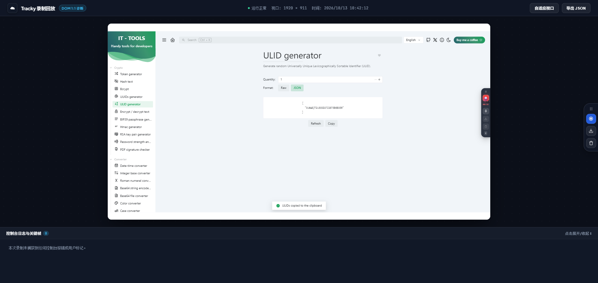

# Tracky 🚀

> 别再发几十兆的 MP4 录屏了。这是一个把 **网页 DOM 变更** 与 **Console 控制台报错** 一起录下来、导出为单文件 HTML 报告的轻量浏览器插件。

[](LICENSE)
[](#安装方式)
[](manifest.json)



---

## 为什么写这个工具？

日常做前端或全栈开发、QA 提测时，最搞心态的事情之一莫过于：

> QA 或产品提了一个 Bug，附件里扔了一个 50MB 的模糊录屏视频。  
> 开发问：“当时控制台报了什么错？接口返回啥状态码？”  
> 答复通常是：“没开控制台 / 没注意看 / 刷新后复现不出来了。”

结果开发只能对着视频猜步骤，反复追问。

**Tracky** 就是为了彻底解决这个痛点写的：
1. **不录视频，录 DOM**：基于 [rrweb](https://github.com/rrweb-io/rrweb) 记录 DOM 变异序列。导出的文件只有几百 KB，体积比视频小几十倍。
2. **像素级 1:1 回放**：回放时是真实的网页元素渲染，支持放大缩小，告别模糊发虚和鼠标漂移。
3. **把报错一起抓下来**：录制时自动拦截 `console.error`、`console.warn`、`window.onerror` 以及未捕获的 Promise 异常。
4. **时序联动**：导出的单文件 HTML 报告自带控制台抽屉，**点击任意一条报错，回放器直接跳到故障发生的瞬间**。
5. **单文件直接丢给开发**：导出的 `.html` 是独立自包含的，直接丢微信、飞书、贴 Jira 或 GitHub Issue，双击浏览器就能看。

---

## 本地 Demo 快速体验

项目中自带了一个开箱即用的交互测试场 [`demo.html`](demo.html)：

```bash
# 安装插件后，直接在浏览器中打开本地 demo.html 即可测试
# 例如: file:///path/to/tracky/demo.html
```

在 `demo.html` 里你可以测试：
- 表单输入与密码字段自动脱敏；
- **点击“💥 触发 Uncaught Error”按钮**，制造一个真实的运行时崩溃；
- 观察 Canvas 动态波形图的录制与回放表现；
- 按 `Alt + R` 录制 10 秒，按 `Alt + M` 标记 Bug，按 `Alt + E` 导出查看最终报告。

---

## 核心特性

- **1:1 视口还原**：自研等比视口计算，支持自由切换【自适应窗口】与【1:1 原始尺寸】，无缩放模糊。
- **自动跳过无操作空闲（Skip Inactive）**：用户停顿发呆的时间自动快进跳过，省去枯燥等待。
- **关键帧打点（Pinpoint Marker）**：操作到出 Bug 的瞬间按一下 `Alt + M`，时间线上直接插上图钉标记。
- **轻量微磨砂控制台**：右侧吸附微型胶囊浮窗，带实时录制毫秒表与呼吸灯指示，支持垂直拖拽。
- **跨域样式与字体保护**：支持 `inlineStylesheet` 与 `collectFonts`，防止外链 CDN 样式丢失导致回放排版坍塌。

---

## 快捷键

| 快捷键 | 作用 |
| :--- | :--- |
| `Alt + R` | **开始 / 停止录制** (带动态数字秒表) |
| `Alt + M` | **标记关键帧** (在时间线上打下当前时刻的书签锚点) |
| `Alt + E` | **导出诊断报告** (生成 `.html` 报告与原始 `.json` 数据) |

---

## 安装方式

无需复杂构建，原生支持 Chrome 与 Edge（Manifest V3）：

1. 克隆或下载本仓库代码到本地；
2. 打开 Chromium 内核浏览器（Chrome、Edge 等），访问扩展管理页：`chrome://extensions`；
3. 打开右上角的 **“开发者模式”** 开关；
4. 点击 **“加载已解压的扩展程序”**，选择本仓库的 `tracky` 目录即可完成安装；
5. 在任意网页右侧即可看到 Tracky 控制条（默认已就绪）。

---

## 开源协议

本项目基于 [MIT 许可证](LICENSE) 开源。

纯粹的开发者工具，100% 免费自由使用。无论是个人日常 Debug、团队提测流程改造还是二次开发，欢迎使用。如果对你有帮助，不妨点个 ⭐️ 支持一下！
